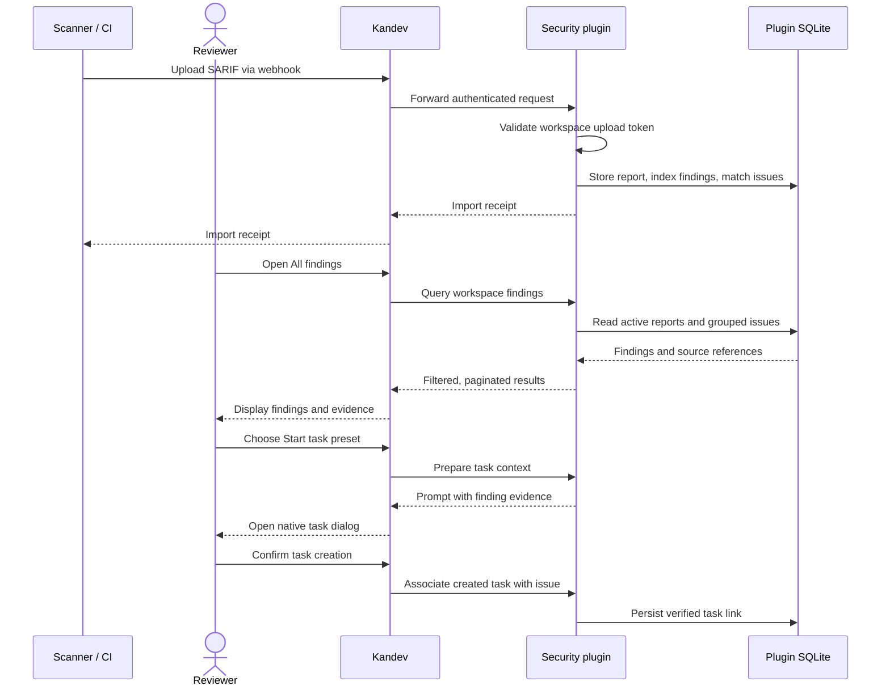

# Kandev Security

A native [Kandev](https://github.com/kdlbs/kandev) plugin for workspace-owned
security reports. Import SARIF from scanners, let AI agents submit findings,
review recurring issues across reports, and start investigation or remediation
tasks with the source evidence attached.

Requires **Kandev 0.99.0 or later**.

## Getting started

1. Build a plugin archive using the [development and packaging](#development)
   instructions below, then install it through **Settings > Plugins**.
2. Open **Security** in the sidebar and select a workspace.
3. Choose **Import SARIF** from the page header menu and upload a report.
4. Review **All findings**, open a finding for details, or use **Start task** to
   prepare a Kandev task.

**All findings** is the default view. The header menu also opens **Advisories**,
**Reports**, **Import SARIF**, **Upload tokens**, and workspace settings. The UI
supports desktop and phone layouts; the chat toolbar shortcut opens `/security`.

For scripts and CI, use the raw-file upload webhook with a workspace upload
token. It accepts up to **16 MiB** per request. When Kandev authentication is
enabled, also supply a Kandev personal access token (PAT). See the
[API guide](docs/api.md) for the curl command and token setup.

The following flow shows how a scanner report becomes findings and a linked task:



## Findings and review

**All findings** combines findings from the workspace's active reports.
**Grouped issues** is enabled by default: reliable matches share a persistent
issue ID, while every original result remains a report occurrence with its
source report and content hash. Switch to **Report occurrences** to see results
individually.

Issue matching uses scanner fingerprints and conservative dependency or code
identities, scoped to the workspace, scanner, rule and source context. Recognized
OSV dependency findings can match across installed versions. Findings without
sufficient matching evidence remain separate. See [issue matching](docs/issues.md)
for the rules and limitations.

Filter by **Language**, **Scanner tool**, **Rule**, **Severity**, and review
**Status** (**All**, **Open**, or **Closed**), with text search across titles,
messages, rule IDs and paths. Filters combine with AND and apply across all
matching pages. Language, scanner and rule selectors are searchable. Click a
severity count to filter; counts honor the other filters while leaving the other
severities visible.

Sorting supports **Severity**, **Newest**, **Oldest**, **Recently updated**, and
**Least recently updated**. Dates use first-import and last-import/reimport
timestamps, rather than scanner detection times. Grouped issues preserve their
first/last import history; report occurrences use their source report's dates.

Language comes from SARIF source-language metadata, then a file-extension
heuristic. Severity uses a valid rule `security-severity` score when supplied:

| Score | Severity |
| --- | --- |
| 9 to 10 | Critical |
| 7 to less than 9 | High |
| 4 to less than 7 | Medium |
| Greater than 0 to less than 4 | Low |
| 0 | Informational |

Otherwise, SARIF `error` maps to High, `warning` to Medium, `note` to Low, and
`none` to Informational. The original SARIF level remains available in report
detail. Agent-authored findings use their declared severity.

Open a finding's drawer for its descriptions, scanner guidance, locations,
snippets, HTTP evidence, suggested fixes, advisory links and source metadata.
The [common finding model](docs/finding-model.md) makes this evidence available
through the UI, API, MCP and task prompts. Descriptions, guidance and fixes
render dedicated SARIF Markdown fields, including code, tables and safe links.
Plain-text fields remain plain text; imported HTML is ignored and images do not
load external resources. Result messages are displayed as plain text, including
when their source is a SARIF Markdown message.

The drawer also shows occurrence history, the matching method, import dates,
linked tasks, and the current review reason. **Close issue** and **Reopen issue**
require a reason and record the verified actor. Imports, report cleanup and task
completion leave review status unchanged. A closed issue records a review
decision; it does not establish verified remediation.

## Advisory view

The separate [Advisories page](docs/advisories.md) at `/security/advisories`
groups CVE/GHSA and producer-scoped vulnerability identifiers across active
reports and scanners. Search, filter by scanner/severity, sort, and drill into
source findings and their tasks.

Advisory groups organize related evidence without merging persistent issues or
sharing their review status. CVE/GHSA aliases are not inferred. Findings without
a recognized advisory identifier remain available in **All findings**.

## Reports and retention

**Reports** offers filename search, a searchable scanner filter,
**Active / All / Archived** buttons with counts, and page navigation. Open a
report to browse its findings, filter by SARIF level, search messages/rules/paths,
export its original SARIF, or delete it. **Upload report** opens the import view.

Use **Archive report** beside **Pin report** to hide a report from default views
while keeping its evidence. **Restore report** includes it again. Archived
reports remain readable by explicit API/MCP selection and are still eligible for
retention unless pinned. See [archiving](docs/archiving.md).

Workspace [report retention](docs/retention.md) is disabled by default. Configure
per-scanner report-count and age limits, scanner overrides, pins, and cleanup
previews through **Security → Report retention**. Settings are shared by the
workspace. Age uses first import; reimporting does not reset it. Cleanup keeps
compact purged-source metadata, issue decisions and task links, while removing
original report bytes and full findings.

## Start tasks from findings

Choose **Start task** on a finding or in its drawer, then select **Investigate**,
**Fix**, **Add regression coverage**, or a custom preset. Kandev's native task
dialog opens with source evidence and exact report references. Review the
prepared prompt and choose the workflow, repository and agent before creating
or starting the task.

Presets are shared by the workspace and edited under **Settings → Workspaces →
your workspace → Integrations → Kandev Security → Task presets**. Created tasks
link to persistent issues and remain discoverable across reports. See the
[task preset guide](docs/task-presets.md) for templates, permissions and recovery.

## Agent and workflow access

The plugin contributes tools through Kandev's native MCP connection for Kanban
and Office task agents, including workflow steps, and owner-approved automation
runs. Enable Kandev MCP in the agent profile. Kandev supplies the authenticated task workspace
and session; no separate MCP server or agent PAT is needed.

For automations, select individual Security tools under **Plugin tools (optional)**
in the automation editor and save. Private runs can read reports, submit findings
and record reviews without creating a normal Kanban task. Plugin reinstallations
or configuration changes require reviewing and selecting the tools again.
See [automation setup](docs/agent-tools.md#automation-setup).

- **Audit reports:** seven read-only tools discover reports, inspect source
  metadata, summarize reports, query findings and filters, and read persistent
  issues. Summary, finding-list and filter queries default to all active workspace
  reports; agents can select 1–50 exact report IDs for a focused audit, including
  archived sources. Results include source hashes, exact finding
  references and provenance gaps. See the [agent audit guide](docs/agent-tools.md).
- **Submit findings:** six draft-lifecycle tools let agents build reports one
  finding at a time. Drafts persist across sessions of the same task; explicit
  completion publishes immutable SARIF. Reports record task/session attribution,
  confidence separately from severity, evidence, scope, actual coverage and
  limitations. Four authoring tools write data; two read drafts. See the
  [report authoring guide](docs/agent-reporting.md).
- **Record review decisions:** `set_issue_status` sets both status and reason.
  Supplying the current status updates only the reason. Changes record verified
  task/session attribution and review history, with retry protection. See
  [agent review updates](docs/agent-tools.md#update-issue-review-status-and-reason).

Scripts and external clients can also use authenticated workspace actions through
the [HTTP API](docs/api.md).

## Import behavior and limits

| Import method | Maximum file size | Authentication |
| --- | --- | --- |
| Browser / chunked actions | 20 MiB | Kandev workspace authorization |
| Raw-file webhook | 16 MiB | Workspace upload token; Kandev PAT when host authentication is enabled |

Both file-import methods accept SARIF **2.1.0**, multiple runs and zero-finding
reports, with at most **50,000 findings** per report. Imports retain the exact
original bytes and publish the report and its indexes in one SQLite transaction.
Invalid or failed imports do not publish partial findings.

SHA-256 detects identical report bytes within a workspace. Reimporting returns
the existing report and updates its last-import timestamp while preserving its
original filename, importer and first-import time. A retry of the same chunked
upload completion does not count as another reimport. New scan output or changed
formatting produces a separate report; issue matching can group recurring
findings without removing their source occurrences.

Parser and transport limits:

- At most 1,000 runs, 100,000 driver rules/artifacts per run, and 128 levels of
  JSON nesting.
- Finding messages up to 8 KiB; rule IDs up to 1 KiB; primary paths and help URIs
  up to 2 KiB; scanner names up to 256 bytes; normalized languages up to 128
  bytes; encoded findings up to 32 KiB; combined run metadata up to 32 KiB.
- Rule and artifact indices resolve against each run's driver rules and artifacts.
  An explicit `-1` means unknown, like an omitted index; URI/rule-ID lookup still
  applies. Other invalid or out-of-range references are rejected.
- The ingestion parser is bounded and does not perform full SARIF JSON Schema
  validation. Message-ID-only results, external property files and extension
  rule tables are not resolved. Materialize result message text before importing.
- Browser/action uploads use **192 KiB chunks** below the host action request
  limit, with offset-checked retries. Unfinished staging expires after 24 hours;
  at most three uploads per workspace and sixteen per installation may be active.
  Reloading the page does not resume an upload.

Paths, repository URLs and evidence references are never fetched automatically.
Large evidence is bounded in detail responses; omitted or shortened fields are
reported. Original SARIF remains available for export while the report is retained.

## Ownership and permissions

Reports, issue reviews, presets and retention settings belong to a Kandev
workspace. Agent drafts additionally belong to the authenticated task. Actions
use Kandev's verified workspace context; ownership is never taken from imported
SARIF or an unverified field inside an action body. There is no additional
per-report owner permission model.

The manifest requests read-only access to **workspaces**, **workflows** and
**tasks** for webhook destination checks, native task launch defaults, and linked
task verification/status. Reports and settings use the plugin's own SQLite
storage. Host state, secret and repository capabilities are not requested.

Workspace upload tokens grant import-only access and are stored as SHA-256
hashes. Their secrets are shown once; tokens survive restarts until revoked.
Webhook imports are attributed to the token issuer. Kandev PATs authenticate
requests at the host and are not forwarded to the plugin. Plugin tokens are
independent credentials: revoke them separately when user or PAT access changes.
See the [API guide](docs/api.md) for authentication details.

## Storage and backups

Kandev injects `KANDEV_PLUGIN_DATA_DIR`; the backend stores its database at:

```text
<KANDEV_PLUGIN_DATA_DIR>/security.db
```

The database holds original SARIF, report metadata and indexes, issue history,
task links, presets, retention settings, upload-token hashes, staging/receipts,
and agent drafts. SQLite uses WAL mode, foreign keys and a busy timeout. The
database is created with private file permissions; a pure Go driver allows
packaging without CGO. The plugin does not encrypt report data.

New databases receive the complete current schema atomically. Current-format
databases reopen without migrations or backfills. Unsupported older development
formats, newer formats and nonempty unversioned databases fail startup without
being reset. For an incompatible development database, keep a backup and use a
new plugin data directory, then explicitly reimport reports. SARIF reimports do
not restore review history, task links, presets, tokens or drafts.

Workspace removal does not automatically purge stored plugin data; its reports
become inaccessible through that workspace's actions. Uninstalling the plugin
removes its data through Kandev's normal lifecycle.

**Back up the plugin data separately.** Stop/disable the plugin before copying
`security.db`, or use SQLite's online backup facility. Copying only the database
file during active WAL writes is insufficient. Restore with matching workspace
IDs in the same Kandev installation. Do not assume Host state backups include
this plugin-owned database.

## Development

Use Go 1.26 and Node 24. The sibling checkout supplies the SDK:

```text
some-directory/
├── kandev/                   # SDK at pluginsdk; packager at apps/backend
└── kandev-security/          # this repository
```

Before running checks, use the revision in [`.kandev-sdk-ref`](.kandev-sdk-ref)
in a dedicated sibling Kandev checkout. `go.mod` replaces
`github.com/kdlbs/kandev/pluginsdk` with `../kandev/pluginsdk`; a different SDK
revision can change transitive Go dependencies. The source pin is separate from the
minimum supported Kandev runtime version.

```sh
npm ci --ignore-scripts
make check-format
make vet
make test
make audit-dependencies
make build
```

`make test` covers database/parser/action tests, UI model and registration tests,
and package/release verifier checks. The dependency audit covers npm test tools.
`ui/bundle.js` is the shipped ES module using Kandev's host UI components and
React; there is no production frontend build step. React, Radix, esbuild and
Playwright in `package.json` support tests.

Browser tests exercise the real UI bundle with React and a mocked host/action
transport on desktop and mobile:

```sh
npx playwright install chromium
npm run test:browser
# Or use a system Chromium:
PLAYWRIGHT_CHROMIUM_EXECUTABLE_PATH=/path/to/chromium npm run test:browser
```

The optional curl smoke test uses the plugin handler and SQLite behind a local
test HTTP bridge; it does not start the Kandev host gateway:

```sh
KANDEV_SECURITY_CURL_SMOKE=1 go test ./server -run TestCurlWebhookUpload -v
```

### Packaging and installation

```sh
make verify-package-host     # Current platform; validates manifest and checksums
make verify-package          # Linux amd64/arm64, macOS amd64/arm64, Windows amd64
make package-file            # Print the archive name for the current version
```

Install the generated `kandev-security-<version>.tar.gz` through **Settings →
Plugins**. Kandev supervises the backend process and injects its data directory.

The optional [installed-host smoke test](scripts/stable-host-smoke.mjs) checks
toolbar registration and navigation against a disposable Kandev v0.99.0 host
with Security installed. It toggles the plugin during testing. Provide a task
route with a composer, the backend log, and a clean checkout of the matching
release with its built `apps/web/dist` assets:

```sh
KANDEV_URL=http://127.0.0.1:18797 \
KANDEV_SMOKE_TASK_PATH=/t/TASK_ID \
KANDEV_RELEASE_SOURCE=/path/to/kandev-v0.99.0 \
KANDEV_SMOKE_HOST_LOG=/path/to/backend.log \
node scripts/stable-host-smoke.mjs
```

## Documentation

| Guide | Topics |
| --- | --- |
| [API](docs/api.md) | Webhook uploads, curl, authentication and workspace actions |
| [Agent audit tools](docs/agent-tools.md) | MCP reads, review updates and audit workflows |
| [Agent report authoring](docs/agent-reporting.md) | Drafts, individual findings, publication and retries |
| [Issue matching](docs/issues.md) | Deduplication, source history and manual review |
| [Common finding model](docs/finding-model.md) | SARIF normalization, evidence and projection limits |
| [Advisories](docs/advisories.md) | Cross-scanner identifier grouping and drill-down |
| [Task presets](docs/task-presets.md) | Shared templates, task context and linked tasks |
| [Report retention](docs/retention.md) | Scanner policies, pins, previews and purging |
| [Archiving](docs/archiving.md) | Archive/restore behavior and report filters |
| [Changelog](CHANGELOG.md) | Development milestones |

## License

MIT. See [LICENSE](LICENSE). Based on the
[kandev-plugin-template](https://github.com/kdlbs/kandev-plugin-template).
